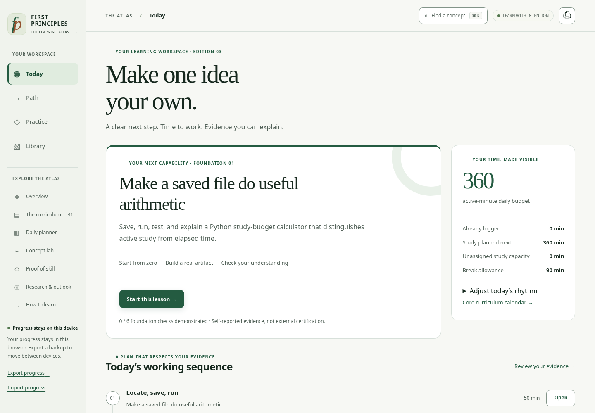
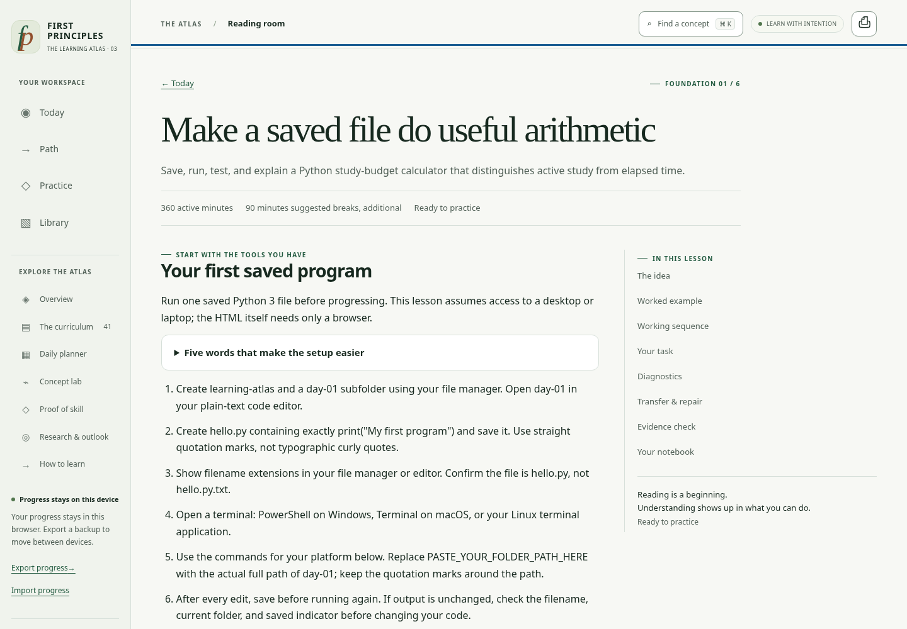

# AI & ML Engineering Roadmap · First Principles

[](https://github.com/MJmuhammadjihad/AI-ML-Engineering-Roadmap/actions/workflows/validate.yml)

**An interactive AI/ML roadmap you can keep in a single HTML file.**

Start from zero with six guided foundation days. Build toward machine learning and AI engineering through 41 modules, 205 further learning sessions, hands-on projects, and checks that ask you to explain what you built.

**[Download edition 03](https://github.com/MJmuhammadjihad/AI-ML-Engineering-Roadmap/releases/download/v3.0.1/first-principles-atlas-v3.html)** · [Watch the 32-second tour](docs/TOUR.md) · [Explore the curriculum](docs/CURRICULUM.md) · [Contribute](CONTRIBUTING.md)

No account. No API key. No install to use the app. Progress stays in your browser, with JSON export when you want to move it.

[](docs/assets/atlas-today.png)

## Start in three steps

1. **Download the HTML** and open the saved file in a modern browser.
2. **Choose Today → Start this lesson.** The first lesson walks you through saving and running a small Python program. Adjust your study budget to fit your day; the default is six active hours, with breaks additional.
3. **Build, explain, and keep your evidence.** Work through the checks, record what you can do independently, and export a progress backup before switching browsers or devices.

The six foundation days are an on-ramp, not a job-readiness promise. Work at the pace your understanding supports. External courses and source links need internet access; the downloaded learning application does not.

## What you get

| Inside the atlas | What it helps you do |
| --- | --- |
| **6 guided beginner days** | Follow 42 authored work blocks, six runnable Python examples, and 18 misconception checks. |
| **41 modules · 205 further sessions** | Connect prerequisites, concepts, practice, deliverables, and review across a larger curriculum. |
| **5 career routes** | Choose AI product engineering, ML engineering, research-oriented engineering, full-stack AI, or the complete atlas. |
| **41 transfer tasks** | Apply an idea to a new problem using an explicit rubric, repair exercise, and reviewer question. |
| **4 capstones · 5 concept labs** | Practice with larger projects and interactive explanations. |
| **A daily workspace** | Plan study blocks, log actual time, keep an evidence notebook, and export progress or calendar events. |
| **Dated research and sources** | Inspect the evidence behind market context and distinguish observations from planning assumptions. |

The planner keeps time spent, completion, assisted practice, and self-reported independent evidence distinct. Reading ahead is available; recommended work follows recorded prerequisite evidence.

<details>
<summary><strong>Preview the guided lesson reader</strong></summary>



</details>

## Choose an edition

| Edition | Focus | Portable HTML | Editable source |
| --- | --- | --- | --- |
| **03 · current** | Guided foundations, daily workspace, deeper transfer checks | [Download](https://github.com/MJmuhammadjihad/AI-ML-Engineering-Roadmap/releases/download/v3.0.1/first-principles-atlas-v3.html) | [ZIP](https://github.com/MJmuhammadjihad/AI-ML-Engineering-Roadmap/releases/download/v3.0.1/first-principles-atlas-v3-source.zip) |
| 02 | Expanded curriculum, worked examples, diagnostics | [HTML](dist/first-principles-atlas-v2.html) | [ZIP](dist/first-principles-atlas-v2-source.zip) |
| 01 | Original 36-module atlas | [HTML](dist/first-principles-atlas-v1.html) | [ZIP](dist/first-principles-atlas-v1-source.zip) |

Earlier editions are preserved byte for byte. The unversioned files in [`dist/`](dist/) are aliases for edition 03. Edition 01/02 progress can be imported into edition 03; the earlier browser storage key is preserved. See [the changelog](CHANGELOG.md).

## Built to be inspectable

The HTML embeds its curriculum, styles, and JavaScript. It makes no analytics or background API requests and uses no runtime CDN, external font, or framework. Local progress storage depends on browser permissions; JSON export remains available if storage is blocked. Keep a backup before moving files or changing browsers.

The published edition 03 has **48 passing browser tests, 22 content tests, and 74 engine checks** recorded in [VALIDATION.md](VALIDATION.md), including 500 seeded scheduling scenarios and execution of the six new Python examples. The report identifies the exact artifact hash and the limits of those checks. Direct-file storage was not verified in the managed test browser, which blocks `file://` navigation.

The [November 2026 market analysis](research/v3-market-research.md) uses nine primary-source entries and a targeted sample of ten job descriptions from three employers. It is not a representative global hiring survey. Study budgets and review intervals are authored planning heuristics; the roadmap does not promise employment or a fixed completion date. Video allocations are study budgets, not verified video durations.

## Run or build locally

Using the downloaded HTML requires only a browser. To edit and rebuild, use Python 3.10+:

```sh
git clone https://github.com/MJmuhammadjihad/AI-ML-Engineering-Roadmap.git
cd AI-ML-Engineering-Roadmap
python3 build.py
python3 -m http.server 8000 --bind 127.0.0.1
```

Open `http://127.0.0.1:8000/dist/first-principles-atlas.html`.

- **Curriculum and interface:** [`src/`](src/)
- **Research and source ledger:** [`research/`](research/)
- **Showcase website:** [`site/`](site/) — build with `python3 build_site.py`, then serve `_site/`.
- **Release packaging:** `python3 package.py` builds versioned artifacts, manifests, and source ZIPs.
- **Development and checks:** [CONTRIBUTING.md](CONTRIBUTING.md) and [VALIDATION.md](VALIDATION.md).

The showcase and GitHub Pages workflow are included. Hosted access is pending repository-owner enablement; [publishing instructions](docs/MAINTAINER-LAUNCH.md) cover the remaining settings.

## Help the next learner

Try a lesson and tell us where you got stuck. [Report a bug](https://github.com/MJmuhammadjihad/AI-ML-Engineering-Roadmap/issues/new?template=bug_report.yml), [improve a lesson](https://github.com/MJmuhammadjihad/AI-ML-Engineering-Roadmap/issues/new?template=lesson_improvement.yml), or [contribute a focused change](CONTRIBUTING.md).

If the atlas is useful to you, **star the repository** to bookmark it and share it with someone learning AI or ML. Specific feedback is especially valuable: which lesson you tried, what you built, and what would make the next step clearer.

[Shareable introductions and a demo script](docs/SHARING.md) · [Release notes](CHANGELOG.md) · [Validation details](VALIDATION.md)

## License

The original code, curriculum, documentation, and project assets are available under the [MIT License](LICENSE). You may use, modify, redistribute, and use them commercially, with the copyright and license notice retained. Linked third-party courses, resources, and attributed quotations remain subject to their respective rights and licenses.
