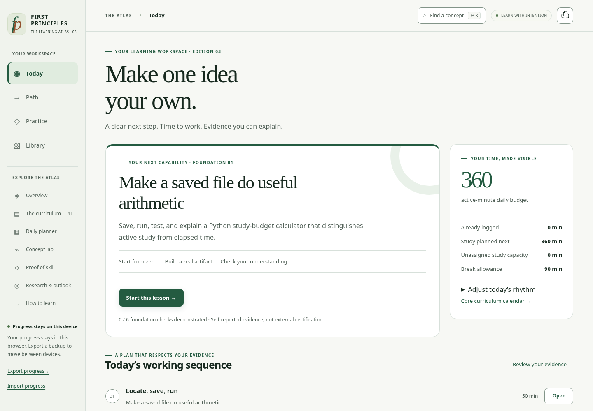

# First Principles in 32 seconds

**[Play the tour online](https://mjmuhammadjihad.github.io/AI-ML-Engineering-Roadmap/assets/atlas-tour.mp4)** · [Download the MP4](https://github.com/MJmuhammadjihad/AI-ML-Engineering-Roadmap/releases/download/v3.0.1/atlas-tour.mp4) · [Browse the curriculum](CURRICULUM.md) · [Open the app](https://mjmuhammadjihad.github.io/AI-ML-Engineering-Roadmap/app/)

[](https://github.com/MJmuhammadjihad/AI-ML-Engineering-Roadmap/releases/download/v3.0.1/atlas-tour.mp4)

A silent, captioned recording of the real application: 32 seconds, 1440 × 1000 pixels, H.264 MP4, approximately 1.3 MB. It uses a fresh demonstration profile and does not mark learning as completed. The showcase website also includes a player with controls and this written tour; it does not autoplay.

## Written tour

1. **Today:** a clear next lesson and an adjustable study budget. Beginners start with a small Python program.
2. **A guided lesson:** a runnable worked example, setup guidance, and a task to attempt yourself.
3. **Evidence checks:** self-reported independent work stays distinct from reading and assisted practice. The demonstration fields remain unassessed.
4. **Path:** five career routes through connected prerequisite modules.
5. **Concept labs:** interactive ways to test a prediction and see a mechanism.
6. **Export:** a JSON progress backup before changing browsers or devices. No account is required.

## Share or reproduce it

Use the MP4 with your own introduction and a link to the repository. The original recording is covered by the [MIT License](../LICENSE); retain the required notice when redistributing project material. See [SHARING.md](SHARING.md) for ready-to-adapt introductions.

The recording script starts a local server, opens an isolated browser profile, navigates the actual app, and adds a caption strip outside its interface. It blocks external requests and exports the recording with FFmpeg. It does not change the application source or anyone's saved progress.

With Python Playwright, Chromium, FFmpeg, and Playwright's video encoder installed:

```sh
python3 -m playwright install ffmpeg
python3 scripts/record_walkthrough.py
```

`CHROMIUM_PATH` can select a Chromium executable; `PLAYWRIGHT_BROWSERS_PATH` can select a writable Playwright encoder cache. The script replaces `docs/assets/atlas-tour.mp4`. A new recording may differ slightly in navigation timing.
